# Latter Day Game

### *Joseph Smith and the gathering of Zion* — a playable first build, illustrated production report, and open 3D character library

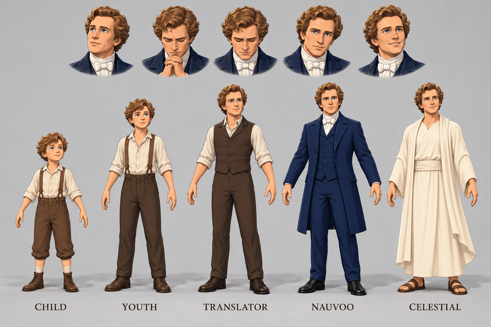

A respectful, historically grounded game concept about **Joseph Smith**, the coming forth of the Book of Mormon, the gathering of Zion, and a speculative celestial continuation. The plan is written as a playable life: revelation and family, scripture and community, suffering and hope, rendered in a warm cel-shaded nineteenth-century world.

This repository is the **backup, production packet, reusable character library, and a playable cel-shaded first build** of that plan. It is a work in progress — not a finished game, not a documentary, and not an official Church product.

**Start here**

- 🎮 **[Run the playable first build](game/README.md)** — the cel-shaded journey (serve locally; see below)
- 📖 **[Read the illustrated report](index.html)** — 32 chapter treatments, casting, art direction, engineering, and sources (open locally)
- 🧍 **[Browse the 3D character library](models/README.md)** — 19 characters, 23 rigged models, previews and download links
- 🗂️ **[Read the model manifest](models/manifest.json)** — hashes, triangle counts, rigs, clips, and original filenames
- ⬇️ **[Download the report ZIP](downloads/JosephSmith-Game-Report.zip)** — the whole packet in one file

> GitHub displays `.html` files as source. Clone or download the repository and open `index.html` in a browser for the report, or serve the root and open `/game/` for the playable build.

---

## Playable first build

<p align="center">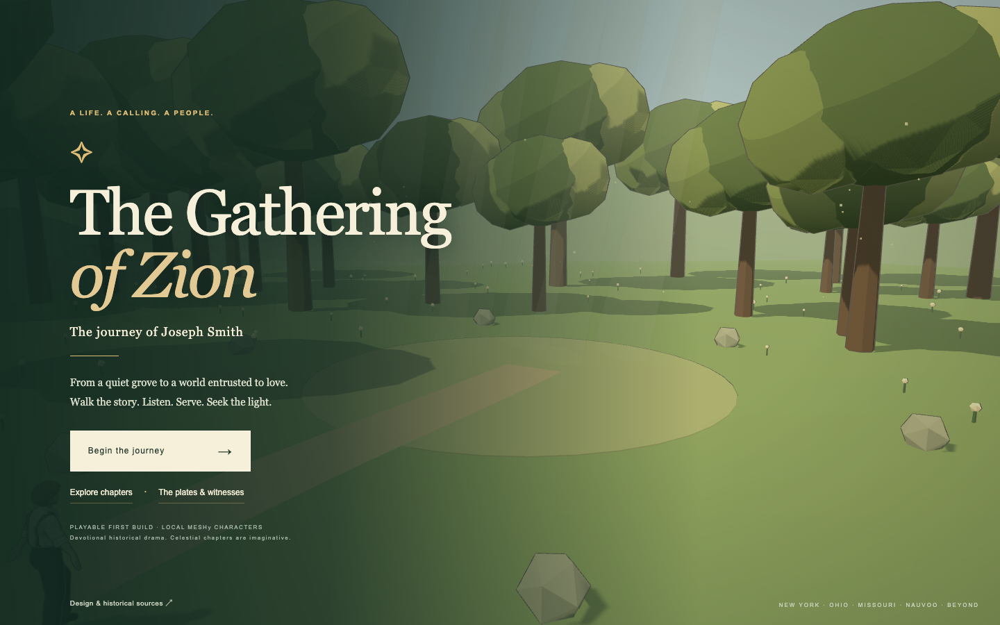</p>

The plan has grown into a playable, cel-shaded first build in [`game/`](game/). It includes the **32 core chapters plus the eight-era Zion expansion** (40 chapters total), the historical cast, the plates and witnesses, chapter select, and the transition from nineteenth-century New York to Ohio, Missouri, Nauvoo, and beyond. Characters are the local Meshy models from this repository, converted to a four-band toon material at runtime.

It is an early build: animation coverage is limited to the clips that exist in the GLBs, facial and finger performance is not rigged, and some crowd roles are explicitly provisional. The historical text, sources, and design notes live in the report.

### Run it locally

The game loads models and chapter data with `fetch`, so it needs an HTTP server — opening `game/index.html` directly will not work.

```bash
# from the repository root
python3 -m http.server 8000
# then open http://localhost:8000/game/
```

**Controls:** `W A S D` to walk · drag to look · `E` to interact · `J` for the journey/chapter view · `V` to toggle the free camera.

<table>
<tr>
<td width="50%">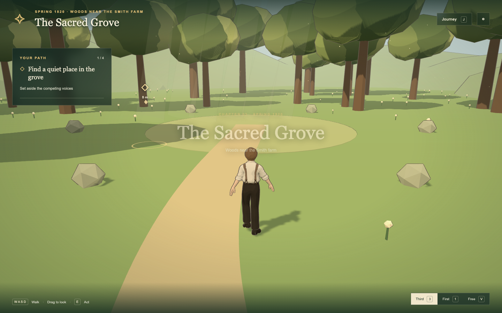<br><sub><b>The Sacred Grove</b> — spring 1820</sub></td>
<td width="50%">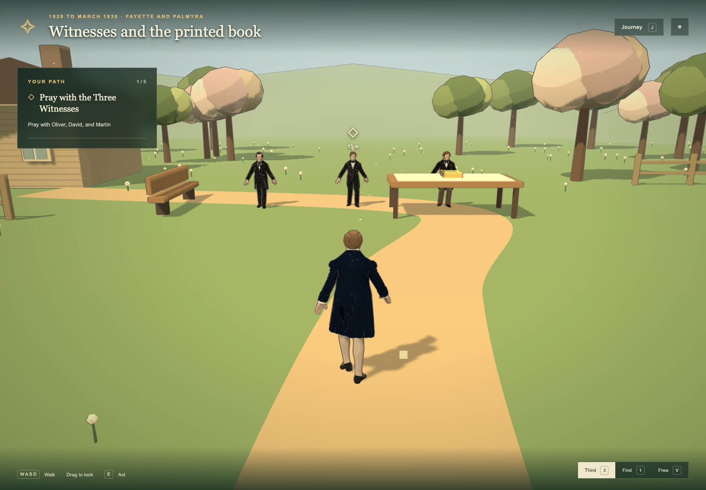<br><sub><b>Witnesses and the printed book</b> — Fayette, 1829</sub></td>
</tr>
</table>

The prebuilt game needs no install. The `package.json` and `tools/` scripts are included for development; see [`game/README.md`](game/README.md) for the asset pipeline and how the public `models/` paths are wired in.

---

## The 3D character library

The `meshy/` exports have been de-duplicated, renamed, and organized into one folder per character. Every character has a **rigged, animated GLB** ready for Blender, Unity, Godot, Unreal, or three.js, plus the unrigged source and remesh stages used to make it.

<table>
<tr>
<td align="center" width="25%"><a href="models/joseph-smith"><br><sub><b>Joseph Smith</b></sub></a></td>
<td align="center" width="25%"><a href="models/emma-smith"><br><sub><b>Emma Hale Smith</b></sub></a></td>
<td align="center" width="25%"><a href="models/hyrum-smith"><br><sub><b>Hyrum Smith</b></sub></a></td>
<td align="center" width="25%"><a href="models/lucy-mack-smith"><br><sub><b>Lucy Mack Smith</b></sub></a></td>
</tr>
<tr>
<td align="center" width="25%"><a href="models/brigham-young"><br><sub><b>Brigham Young</b></sub></a></td>
<td align="center" width="25%"><a href="models/oliver-cowdery"><br><sub><b>Oliver Cowdery</b></sub></a></td>
<td align="center" width="25%"><a href="models/moroni"><br><sub><b>Moroni</b></sub></a></td>
<td align="center" width="25%"><a href="models/nephi"><br><sub><b>Nephi</b></sub></a></td>
</tr>
</table>

**Included characters**

Joseph Smith (child, teen, and adult) · Joseph Smith Sr. · Emma Hale Smith · Hyrum Smith · Lucy Mack Smith · Brigham Young · Oliver Cowdery · Martin Harris · David Whitmer · Jacob Whitmer · John Whitmer · Sidney Rigdon (young and older) · Moroni · Nephi · Laman · Lemuel · Alma the Younger · Heavenly Father · John the Baptist

**At a glance**

| | |
|---|---|
| Characters | 19 |
| GLB files | 57 (23 rigged) |
| Rig | Humanoid Mixamo-style, 22–24 body joints |
| Clips | Usually `Running` + `Walking`; a few rigs add extra clips |
| Textures | Embedded 2K/4K atlases |
| Format | Binary glTF 2.0, Y-up, meters |
| License | MIT, with attribution requested |

The full library is about **1.5 GB**. To clone only the models:

```bash
git clone --depth 1 --filter=blob:none --sparse https://github.com/xirtus/LatterDayGame.git
cd LatterDayGame
git sparse-checkout set models
```

> **Note on the scans:** these are AI-generated preproduction assets. They are not documentary likenesses, and the sacred figures are reverent artistic interpretations rather than official doctrinal depictions. Facial likeness, historical costume, and cultural detail still need review before production use.

---

## The plan boards

The visual plan was built as a set of illustrated contact sheets. These are the same boards used inside the report.

### Joseph across his life


### Family and witnesses

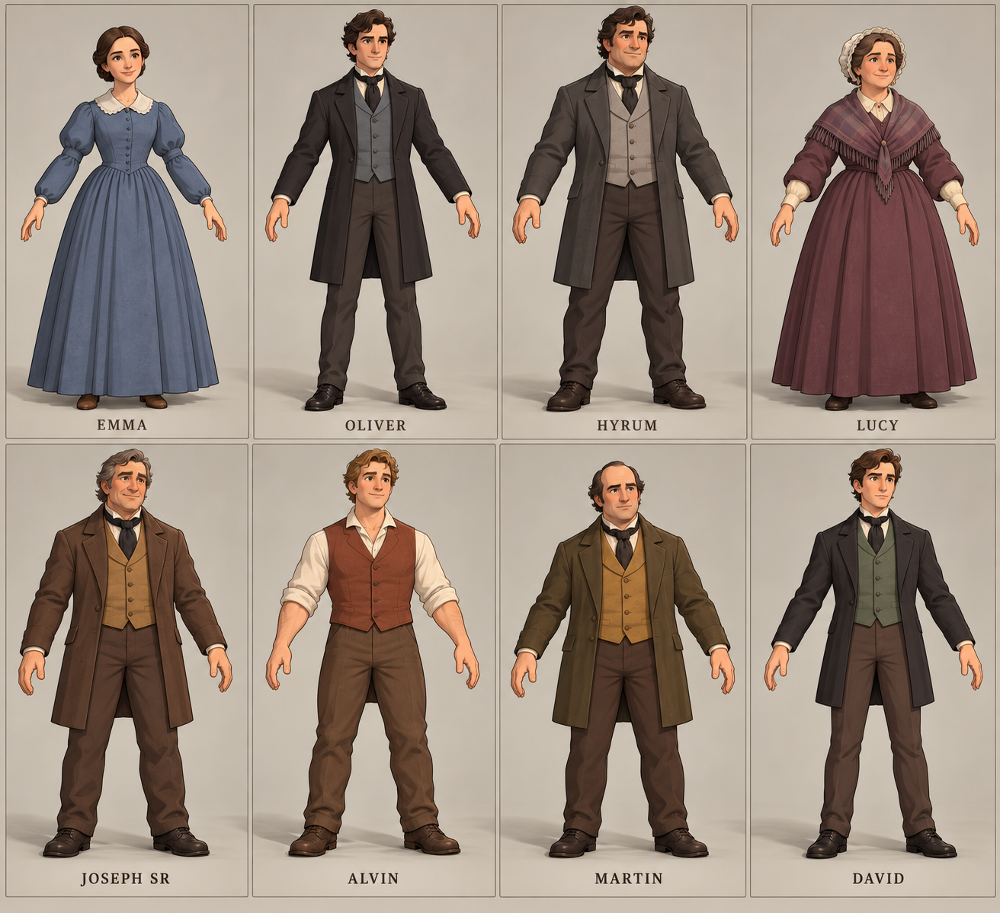

### Community and leadership

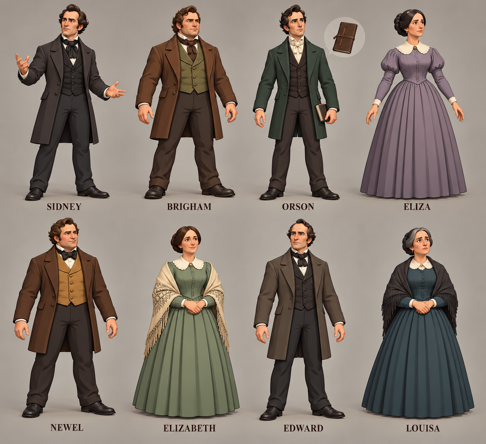

### Sacred visitors

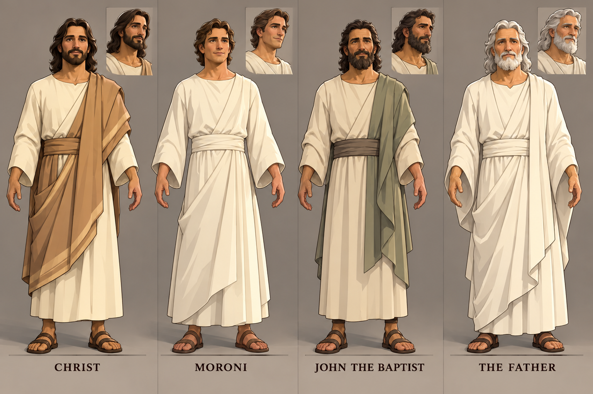

### The 32 chapters

<table>
<tr>
<td width="50%"><a href="art/chapters-01-08.png">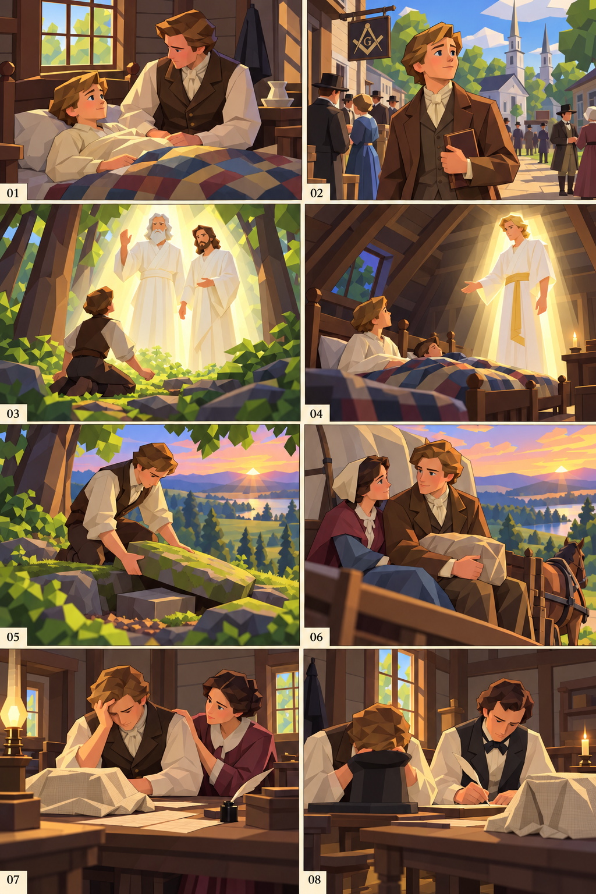</a><br><sub><b>Chapters 01–08</b> — childhood, the Grove, Moroni, the plates</sub></td>
<td width="50%"><a href="art/chapters-09-16.png">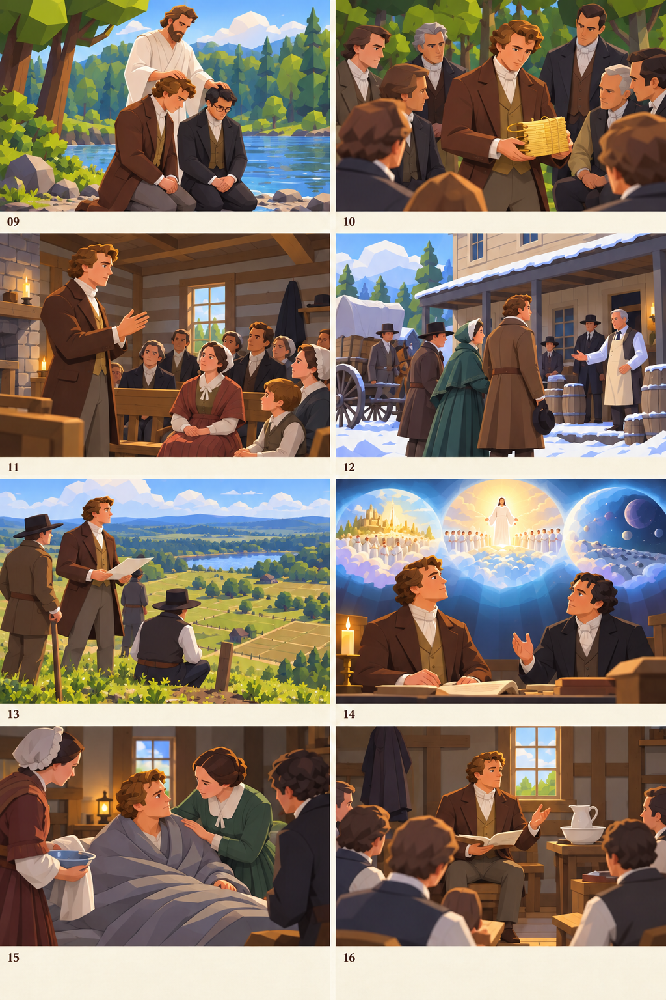</a><br><sub><b>Chapters 09–16</b> — translation, witnesses, Kirtland</sub></td>
</tr>
<tr>
<td width="50%"><a href="art/chapters-17-24.png">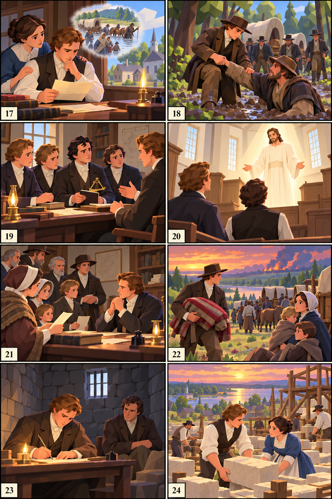</a><br><sub><b>Chapters 17–24</b> — Missouri, Nauvoo, the wider community</sub></td>
<td width="50%"><a href="art/chapters-25-32.png">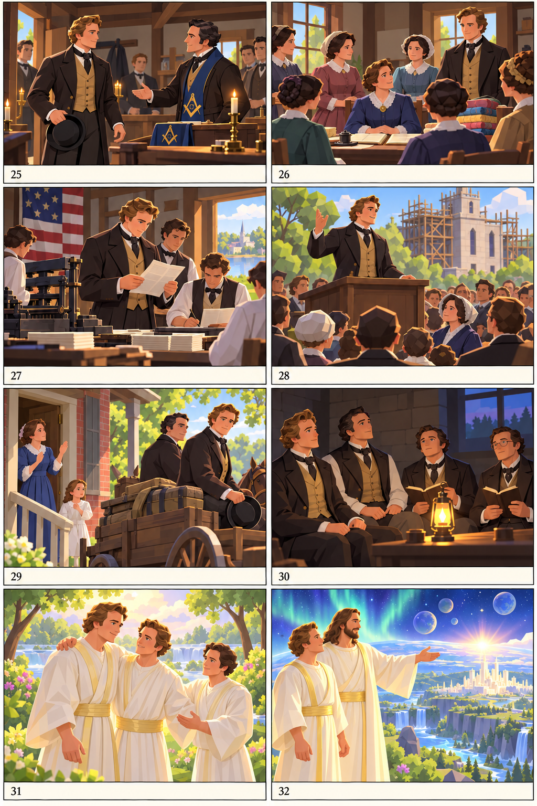</a><br><sub><b>Chapters 25–32</b> — King Follett, Carthage, and the celestial continuation</sub></td>
</tr>
</table>

### Seven eras and the Zion campaign

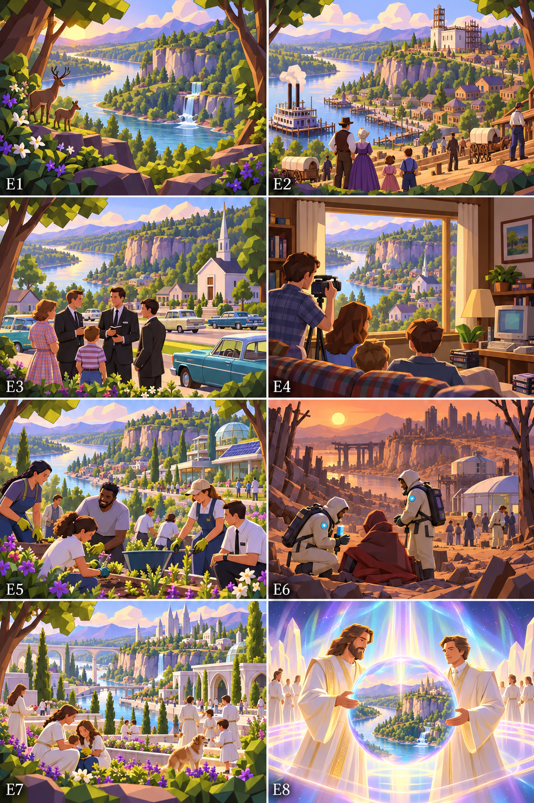

The optional expansion follows a through-line from a untouched river valley to Nauvoo, the 1950s, 1994, 2026, a far future, and a celestial Zion — a study in how a place remembers its promises.

---

## The report

The illustrated report is a single local HTML file. Open [`index.html`](index.html) in a browser; it needs no server.

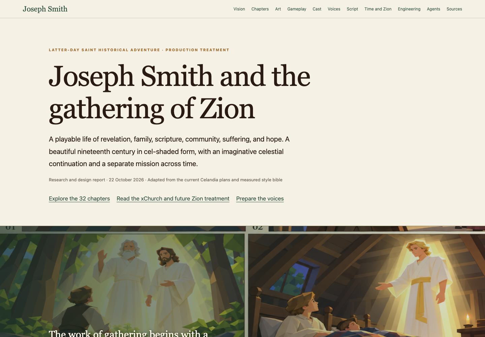

Inside the report:

- **32 chapter treatments** with dates, history, play, art direction, and sources
- **40 concept panels** across the five boards above
- **65 casting and voice-family briefs**, with audition lines and performance states
- Working scene dialogue, the King Follett sermon adaptation, and source notes
- The MOSSlanding voice-production workflow and the xChurch-inspired seven-era Zion expansion
- A live **material study** comparing the original Meshy texture with a four-band toon material

<table>
<tr>
<td width="50%">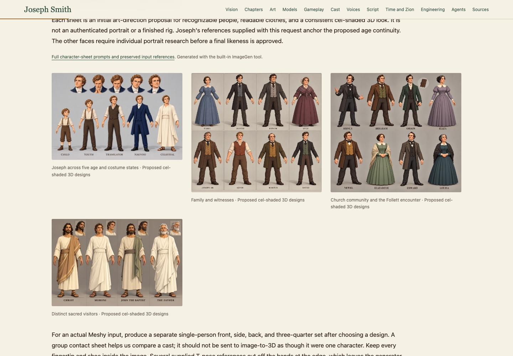</td>
<td width="50%">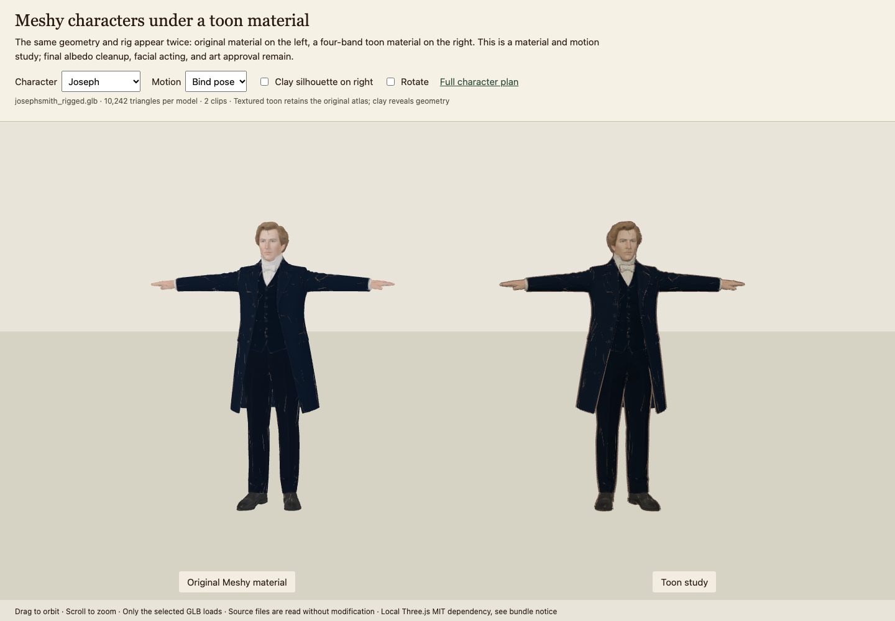</td>
</tr>
</table>

The `character-study/` folder contains the interactive three.js comparison. It needs a local HTTP server because it loads GLBs:

```bash
python3 -m http.server 8000
# then open http://localhost:8000/character-study/
```

---

## What is in the repository

```text
.
├── README.md                  # this file
├── index.html                 # the illustrated report
├── LICENSE                    # MIT
├── art/                       # concept boards, character sheets, references
├── character-study/           # live original/toon material comparison
├── docs/                      # campaign, cast, dialogue, prompts, sources, evidence
├── downloads/                 # JosephSmith-Game-Report.zip
├── game/                      # playable cel-shaded first build
│   ├── content/               # chapter and asset manifests
│   ├── dist/                  # built game JS
│   ├── evidence/              # menu and world captures
│   └── src/                   # world, story, actors, audio
├── package.json               # game dev scripts and dependencies
├── models/                    # the reusable 3D character library
│   ├── README.md              # gallery, download links, rig notes
│   ├── manifest.json          # hashes, triangles, rigs, clips, old filenames
│   ├── catalog.csv            # spreadsheet-friendly catalog
│   └── <character>/           # rigged GLB + source stages + preview.png
└── tools/                     # report builder, organizer, preview renderer
```

### Production documents

| File | What it contains |
|---|---|
| [`docs/campaign.json`](docs/campaign.json) | 32 chapters with dates, history, play, art, and sources |
| [`docs/cast.json`](docs/cast.json) | Character voice descriptions, states, and auditions |
| [`docs/dialogue.json`](docs/dialogue.json) | Working dialogue beats |
| [`docs/sermon-passages.json`](docs/sermon-passages.json) | Adapted King Follett doctrinal passages |
| [`docs/voice-cast.csv`](docs/voice-cast.csv) | Casting and voice-preparation export |
| [`docs/recording-manifest.csv`](docs/recording-manifest.csv) | Scene recording and selected-take export |
| [`docs/modeling-plan.json`](docs/modeling-plan.json) | Modeling priorities, cast grouping, and the model prompt |
| [`docs/modeling-roster.csv`](docs/modeling-roster.csv) | Every voice profile with model status |
| [`docs/character-art-prompts.json`](docs/character-art-prompts.json) | Character-sheet prompts and saved references |
| [`docs/art-prompts.json`](docs/art-prompts.json) | Full initial/revision prompts for every board |
| [`docs/sources.json`](docs/sources.json) | Source titles, links, and how each is used |
| [`docs/design.html`](docs/design.html) | Design, theology, engineering, and production prose |
| [`docs/project-notes.txt`](docs/project-notes.txt) | Original working notes for the packet |
| [`docs/evidence/`](docs/evidence/) | Desktop/mobile report captures and study screenshots |

---

## Building and maintaining

The report and CSV exports are generated from the JSON in `docs/`:

```bash
python3 tools/build_report.py
```

Refresh the model inventory after new Meshy exports:

```bash
python3 tools/organize_models.py --source meshy --render
```

After regenerating the game's asset manifest, repoint it at the organized library:

```bash
python3 tools/rewrite_game_assets.py
```

The game's original asset builder expects a local `meshy/` source folder; the public repository uses the renamed `models/` tree, and the rewriter maps the original filenames to the new paths.

Rebuild the interactive material study with the existing Celandia dependencies:

```bash
node tools/build_character_study.mjs
```

The organizer copies the source models (it never modifies `meshy/`), writes the manifest and catalog, and renders consistent previews with Blender's Workbench engine. The preview renderer is `tools/render_model_preview.py`.

---

## Using the models

- **Game engines:** import the `*-rigged.glb` directly. The skeleton is humanoid and Mixamo-style; retargeting is straightforward.
- **Static tableau or crowd:** use the `*-remeshed.glb`, `*-10k.glb`, or `*-optimized.glb` versions to keep draw calls and triangle counts down.
- **Close-up work:** the scans have 300k–1.3M triangles and 4K textures, but no facial blendshapes or finger joints. Plan custom face rigs for acting shots.
- **Materials:** Meshy rigged exports sometimes bind the same texture as both base color and emissive. If a model looks washed out, disconnect the emissive texture or set emission strength to zero.
- **Scale:** one unit is one meter; the characters are about 1.7–1.9 m tall.

If you use the library, credit **Latter Day Game / xirtus** and keep [`models/README.md`](models/README.md) with the assets. The repository is MIT-licensed; see [`LICENSE`](LICENSE).

---

## Sources and stance

The report is a **faithful but non-official** artistic treatment. It draws on published histories, Joseph Smith's own accounts, the Doctrine and Covenants, contemporary newspapers, and standard reference works; the full list with links is in [`docs/sources.json`](docs/sources.json). Scripture and sermon passages are adapted for drama, not presented as critical editions.

This project is not affiliated with or endorsed by The Church of Jesus Christ of Latter-day Saints. It is an independent preproduction study. Historical reconstruction, sacred depiction, and AI-generated concept art all require human review before anything is published or performed.

---

*Prepared 22 October 2026. Report and art by Andreas Xirtus. Character models generated with [Meshy](https://www.meshy.ai/).*
